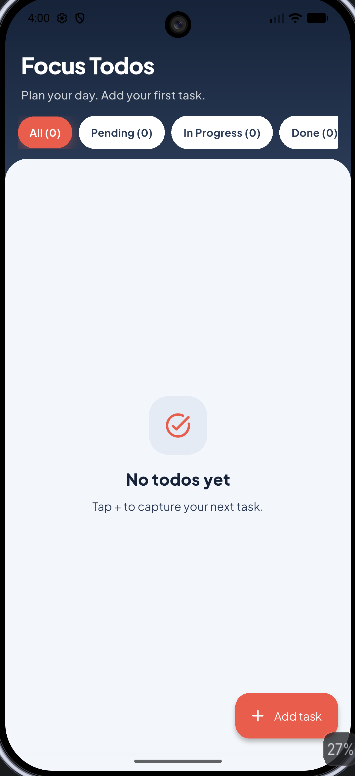
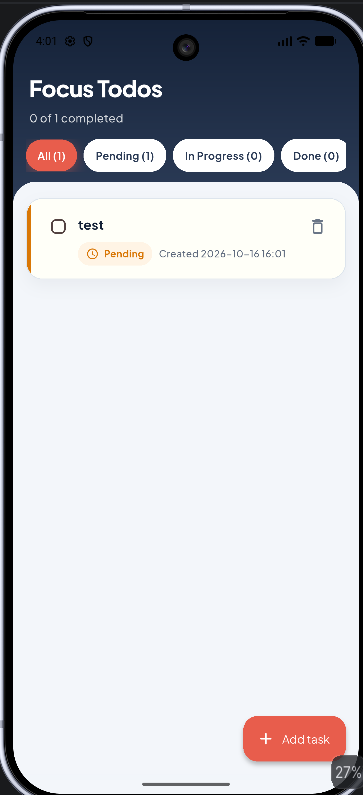
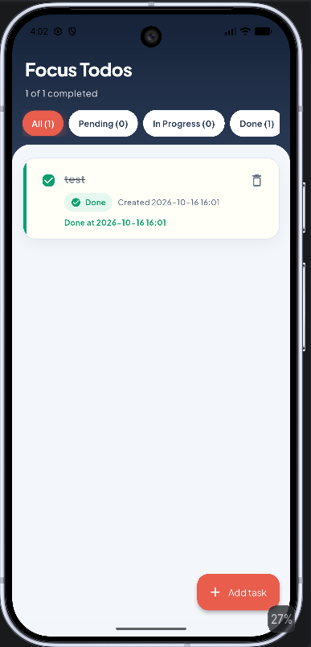

# Focus Todos — Flutter Hive + Bloc

A Flutter todo app with **Hive** local persistence, **flutter_bloc** state management, and a polished **Focus Studio** UI.

**Repository:** https://github.com/devDoniaAlhosin/todo-app-hive-bloc.git

## Screenshots

Screenshots are stored in [`screenshots/`](screenshots/).

### Empty state


### Pending task


### Done task (with Done at timestamp)


## Features

- **Add todo** — extended FAB opens a styled dialog; enter a title, pick a status, save
- **Statuses** — `Pending`, `In Progress`, `Done` with color-coded badges
- **Status filters** — horizontal pills with live counts
- **Done timestamp** — stores and shows **Done at** when a task is completed
- **Created timestamp** — each card shows when the task was created
- **Change status** — tap the status badge to switch
- **Toggle complete** — checkbox marks Done / Pending and moves the task into the matching status filter
- **Progress summary** — header shows `X of Y completed`
- **Empty states** — friendly illustrations for no tasks / empty filter
- **Delete todo** — remove from the list
- **Persist with Hive** — todos, statuses, and timestamps survive restarts
- **Bloc architecture** — events → bloc → repository → Hive → UI states
- **Polished UI** — ink/mist/coral theme, Plus Jakarta Sans, gradient header, card list

## UI design (Focus Studio)

| Token | Role |
|-------|------|
| Ink navy (`#152238`) | Header / strong text |
| Mist (`#F3F6FA`) | Page background |
| Coral (`#E85D4C`) | Primary actions (FAB, buttons) |
| Amber | Pending status |
| Blue | In Progress status |
| Green | Done status |

Highlights:
- Gradient hero header with completion summary
- Soft rounded content sheet
- Status accent bar on each task card
- Color chips for filters and status selection
- No DEBUG banner in the app shell

## Architecture

```
UI (TodoPage / widgets)
  → TodoBloc (events / states)
    → TodoRepository
      → Hive box (`todos_v2`)
```

### Events

| Event | Description |
|-------|-------------|
| `LoadTodos` | Load all todos from Hive |
| `AddTodo(title, status)` | Create a new todo with a status |
| `ChangeTodoStatus(id, status)` | Set Pending / In Progress / Done |
| `ToggleTodo(id)` | Quick toggle between Done and Pending |
| `FilterTodos(status)` | Filter list by status (`null` = all) |
| `DeleteTodo(id)` | Remove a todo |

### States

| State | Description |
|-------|-------------|
| `TodoInitial` | Starting state |
| `TodoLoading` | Loading todos |
| `TodoLoaded(todos, filter)` | Todos ready (+ optional filter) |
| `TodoFailure(message)` | Something went wrong |

## Project structure

```
lib/
  main.dart
  theme/
    app_colors.dart
    app_theme.dart
  models/
    todo.dart
    todo_status.dart
  repositories/
    todo_repository.dart
  bloc/
    todo_event.dart
    todo_state.dart
    todo_bloc.dart
  screens/
    todo_page.dart
  widgets/
    todo_tile.dart
    add_todo_dialog.dart
  utils/
    date_format.dart
screenshots/
  01_empty_state.png
  02_pending_task.png
  03_done_task.png
```

## Tech stack

- Flutter
- hive / hive_flutter
- flutter_bloc / equatable
- uuid
- google_fonts (Plus Jakarta Sans)
- hive_generator + build_runner

## Getting started

```bash
flutter pub get
flutter run
```

Regenerate Hive adapters (after model changes):

```bash
dart run build_runner build --delete-conflicting-outputs
```

Tests:

```bash
flutter test
```

## How to use

1. Launch the app — todos load from Hive.
2. Tap **Add task** to create a todo and choose a status.
3. Use filter pills to view All / Pending / In Progress / Done.
4. Tap a status badge to change status; checkbox marks Done quickly.
5. When Done, the card shows **Done at** date/time.
6. Close and reopen — data persists.
